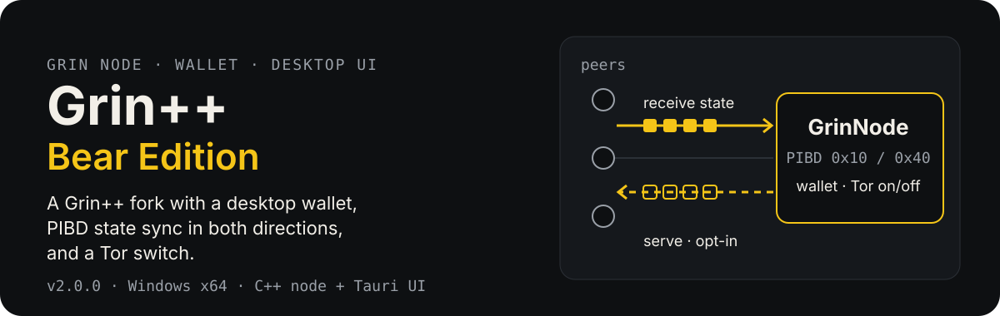

**English** · [Русский](README.ru.md)

<p align="center">
  
</p>

A fork of [GrinPlusPlus/GrinPlusPlus](https://github.com/GrinPlusPlus/GrinPlusPlus): a C++ Grin node, a wallet service and a desktop UI (Tauri + React) in one Windows kit. This branch (`main`) holds **releases only**. The full source and history are in the [`Main`](https://github.com/DanilaGrinRus/GrinPlusPlusBearEdition/tree/Main) branch and the other branches of the fork.

## Download

| Release | What it is | Get it |
|---|---|---|
| **Grin++ 2.0.0** | node + wallet + UI; PIBD receive and serve; Tor switch | [v2.0.0](https://github.com/DanilaGrinRus/GrinPlusPlusBearEdition/releases/tag/v2.0.0) |
| **Node Beta 1.2.9** | frozen node-only Beta (Windows + Linux + source) | [beta-1.2.9](https://github.com/DanilaGrinRus/GrinPlusPlusBearEdition/releases/tag/beta-1.2.9) |

The full portable archives are attached to the releases. SHA-256 sums are in [`releases/Grin++-2.0/SHA256SUMS.txt`](releases/Grin++-2.0/SHA256SUMS.txt); the node and UI sources the kit was built from are in [`releases/Grin++-2.0/sources/`](releases/Grin++-2.0/sources).

## What has been checked

- **Grin++ 2.0.0:** full test suite — 493 test cases, 19,498 assertions PASS (run before the Tor switch was added). After that change the kit was rebuilt and checked live: Tor on/off, node reaches `FULLY_SYNCED`, wallet on 3421, UI controls.
- **PIBD:** live PASS in both directions on floonet and mainnet.
- **Node Beta 1.2.9:** 468/468 PASS on the frozen pair; Linux 464/464 PASS. Mainnet sync on Linux is **not verified**. Details and limits: [`releases/Beta/README.md`](releases/Beta/README.md).

## What is different from upstream

- **PIBD in both directions** (0x10 / 0x40). The node takes chain state from the horizon over PIBD and can **serve** its own archive to other nodes. On mainnet, serving stays off until you confirm it explicitly (`PIBD_ARCHIVE_SERVING_MAINNET=true`).
- **Transaction by kernel hash** (TX_KERNEL_HASH, 0x08; messages 19/20).
- **Node control from the UI:** start / stop / restart, Mainnet / Floonet switch, **Tor switch** (`TOR.ENABLE_TOR` in `server_config.json`, applied after a restart).
- **Desktop wallet:** create / restore (12 / 18 / 24 words, seed hiding), send and receive with slatepack + QR, history with filters, balance hiding.
- Per-module logs (node / wallet / UI) with filters and a start-up timeline. Russian and English.

## Quick start (Grin++ 2.0)

1. Download the portable archive from [v2.0.0](https://github.com/DanilaGrinRus/GrinPlusPlusBearEdition/releases/tag/v2.0.0) and unpack it.
2. Run `Start Grin++.cmd`. The UI finds `GrinNode.exe` next to it and keeps its data in `.GrinPP\` in the same folder.
3. In the UI: **Node → Start**, then **Create wallet** or **Restore wallet**.

<details>
<summary>Installer instead of the portable kit</summary>

Run `Grin++_2.0.0_x64-setup.exe`, then put `GrinNode.exe` and the `tor\` folder next to the installed `grinpp-desktop.exe` (or into a `node\` subfolder).
</details>

<details>
<summary>Node Beta 1.2.9 (node only)</summary>

```powershell
.\beta\start-node.ps1 -ConfigPath <config.json>
```
</details>

## Network

| Port | Purpose | Open to the internet? |
|---|---|---|
| 3414 | P2P | only if you want inbound peers |
| 3413 | REST | no — loopback only |
| 3421 | wallet | no — loopback only |

Outbound connections are enough for syncing and for the wallet. To accept inbound peers or serve PIBD to strangers, open TCP 3414: see [docs/P2P.md](docs/P2P.md) and [`docs/enable-p2p-firewall.cmd`](docs/enable-p2p-firewall.cmd). Tor is not required for normal P2P; it is only needed for `.onion` addresses.

## Limits

- Windows x64 for 2.0.0.
- With `ENABLE_TOR=false`, Tor addresses and hidden services are unavailable.
- Inbound P2P needs an open port 3414 (NAT / firewall); behind CGNAT the node still works with outbound connections only.
- Public mainnet reorg, 24-hour stability and full sync on Linux / FreeBSD / macOS are not verified for the Beta.

## Repository layout

```text
README.md, README.ru.md
assets/readme/      README images
releases/
  Grin++-2.0/       README, SHA256SUMS, installer, sources/
  Beta/             README: freeze, artefacts, limits
docs/
  P2P.md, enable-p2p-firewall.cmd
```

No secrets, seed phrases, `.api_secret` files or network data are stored here.
