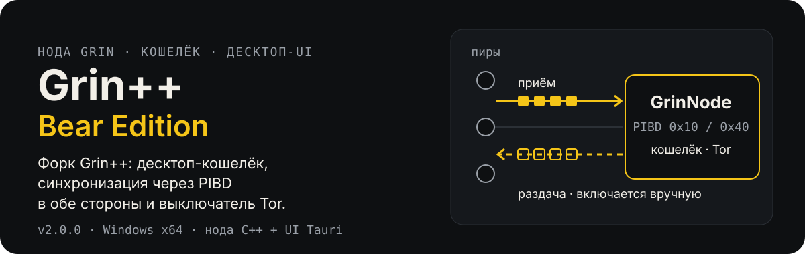

[English](README.md) · **Русский**

<p align="center">
  
</p>

Форк [GrinPlusPlus/GrinPlusPlus](https://github.com/GrinPlusPlus/GrinPlusPlus): нода Grin на C++, кошелёк-сервис и десктопный UI (Tauri + React) в одном комплекте для Windows. Эта ветка (`main`) — **только релизы**. Полный исходный код и история — в ветке [`Main`](https://github.com/DanilaGrinRus/GrinPlusPlusBearEdition/tree/Main) и остальных ветках форка.

## Скачать

| Релиз | Что это | Скачать |
|---|---|---|
| **Grin++ 2.0.0** | нода + кошелёк + UI; приём и раздача PIBD; выключатель Tor | [v2.0.0](https://github.com/DanilaGrinRus/GrinPlusPlusBearEdition/releases/tag/v2.0.0) |
| **Node Beta 1.2.9** | замороженный node-only Beta (Windows + Linux + исходники) | [beta-1.2.9](https://github.com/DanilaGrinRus/GrinPlusPlusBearEdition/releases/tag/beta-1.2.9) |

Полные portable-архивы приложены к релизам. Контрольные суммы SHA-256 — в [`releases/Grin++-2.0/SHA256SUMS.txt`](releases/Grin++-2.0/SHA256SUMS.txt); исходники ноды и UI, из которых собран комплект, — в [`releases/Grin++-2.0/sources/`](releases/Grin++-2.0/sources).

## Что проверено

- **Grin++ 2.0.0:** полный набор тестов — 493 кейса, 19 498 assertions PASS (прогон до добавления выключателя Tor). После этого комплект пересобран и проверен вживую: Tor вкл/выкл, нода доходит до `FULLY_SYNCED`, кошелёк на 3421, элементы UI.
- **PIBD:** live PASS в обе стороны на floonet и mainnet.
- **Node Beta 1.2.9:** 468/468 PASS на замороженной паре; Linux 464/464 PASS. Синхронизация mainnet на Linux **не проверена**. Подробности и ограничения: [`releases/Beta/README.md`](releases/Beta/README.md).

## Чем отличается от оригинала

- **PIBD в обе стороны** (0x10 / 0x40). Нода принимает состояние цепи с горизонта через PIBD и может **раздавать** свой архив другим нодам. На mainnet раздача выключена, пока вы явно её не подтвердите (`PIBD_ARCHIVE_SERVING_MAINNET=true`).
- **Транзакция по хэшу ядра** (TX_KERNEL_HASH, 0x08; сообщения 19/20).
- **Управление нодой из UI:** запустить / остановить / перезапустить, переключение Mainnet / Floonet, **выключатель Tor** (`TOR.ENABLE_TOR` в `server_config.json`, применяется после перезапуска).
- **Десктоп-кошелёк:** создание и восстановление (12 / 18 / 24 слова, скрытие seed), отправка и приём через slatepack + QR, история с фильтрами, скрытие баланса.
- Логи по модулям (нода / кошелёк / UI) с фильтрами и таймлайном запуска. Русский и английский.

## Быстрый старт (Grin++ 2.0)

1. Скачайте portable-архив из [v2.0.0](https://github.com/DanilaGrinRus/GrinPlusPlusBearEdition/releases/tag/v2.0.0) и распакуйте.
2. Запустите `Start Grin++.cmd`. UI сам находит `GrinNode.exe` рядом, данные хранит в `.GrinPP\` той же папки.
3. В UI: **«Нода» → «Запустить»**, затем **«Создать кошелёк»** или **«Восстановить кошелёк»**.

<details>
<summary>Установщик вместо portable-комплекта</summary>

Запустите `Grin++_2.0.0_x64-setup.exe`, затем положите `GrinNode.exe` и папку `tor\` рядом с установленным `grinpp-desktop.exe` (или в подпапку `node\`).
</details>

<details>
<summary>Node Beta 1.2.9 (только нода)</summary>

```powershell
.\beta\start-node.ps1 -ConfigPath <config.json>
```
</details>

## Сеть

| Порт | Назначение | Открывать наружу? |
|---|---|---|
| 3414 | P2P | только если нужны входящие пиры |
| 3413 | REST | нет — только loopback |
| 3421 | кошелёк | нет — только loopback |

Для синхронизации и кошелька достаточно исходящих соединений. Чтобы принимать входящих пиров или раздавать PIBD незнакомым нодам, откройте TCP 3414: см. [docs/P2P.md](docs/P2P.md) и [`docs/enable-p2p-firewall.cmd`](docs/enable-p2p-firewall.cmd). Tor для обычного P2P не обязателен, он нужен только для `.onion`-адресов.

## Ограничения

- 2.0.0 — только Windows x64.
- При `ENABLE_TOR=false` Tor-адреса и скрытые сервисы недоступны.
- Для входящих P2P нужен открытый порт 3414 (NAT / firewall); за CGNAT нода продолжает работать только исходящими соединениями.
- Для Beta не проверены: реорганизация публичного mainnet, стабильность 24 часа, полная синхронизация на Linux / FreeBSD / macOS.

## Структура репозитория

```text
README.md, README.ru.md
assets/readme/      картинки README
releases/
  Grin++-2.0/       README, SHA256SUMS, установщик, sources/
  Beta/             README: freeze, артефакты, ограничения
docs/
  P2P.md, enable-p2p-firewall.cmd
```

Секретов, seed-фраз, `.api_secret` и данных сети здесь нет.
